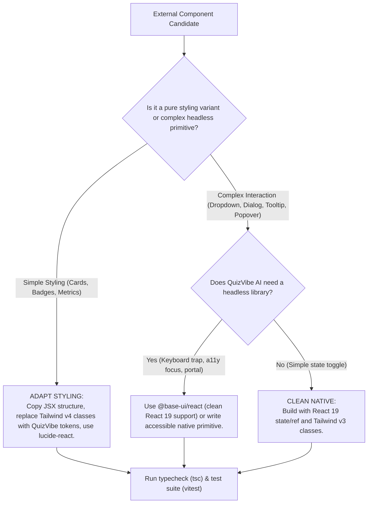

# Safe Component Integration Guide

## 1. Purpose
Define the technical rules, architectural guardrails, and verification workflows for adapting components from external reference repositories (**Shadcn Dashboard**, **Origin UI**, and **Blocks.so**) into QuizVibe AI without introducing dependency bloat, React 19 peer-dependency conflicts, or Tailwind v4 styling regressions.

---

## 2. When to Use
Invoke this skill whenever:
- Adding a new UI primitive (e.g. `dialog`, `dropdown`, `tooltip`, `popover`, `sidebar`, `table`) to `src/components/ui`.
- Adapting a complex pattern (e.g. `stats-01`, `table-02`, `input-group`, `composer`) from reference repositories into QuizVibe AI.
- Evaluating a third-party npm package before installation.
- Refactoring existing components to improve accessibility or visual polish.

---

## 3. Technology Stack Comparison & Translation Rules

### 3.1 Stack Differences
| Dimension | QuizVibe AI (Target App) | Reference Repositories | Action Required |
| :--- | :--- | :--- | :--- |
| **React** | React 19.0.0 | React 19.1.x / 19.2.x | **Directly Compatible** — React 19 primitives work smoothly. |
| **Tailwind CSS** | **Tailwind CSS v3.4.17** | **Tailwind CSS v4.x** | **MUST ADAPT:** Reference code uses Tailwind v4 `@theme` and new syntax. Must convert to Tailwind v3 utility classes and QuizVibe AI HSL tokens. |
| **Headless Primitive**| Zero external headless libs | `@base-ui/react` (Base UI) | **Prefer Base UI** over Radix UI when headless primitives are needed, as Base UI natively supports React 19 without peer-dependency conflicts. |
| **Icon Library** | `lucide-react` (0.470.0) | `lucide-react`, `@hugeicons`, `@tabler` | **Enforce Single Icon Source:** Replace any `@hugeicons` or `@tabler` icons with equivalent icons from `lucide-react`. |
| **Utility Helper** | `src/lib/utils.ts` (`cn`) | `clsx` + `tailwind-merge` | **Directly Compatible** — QuizVibe AI already has `cn(...)` combining `clsx` and `tailwind-merge`. |

### 3.2 Tailwind v4 to Tailwind v3 Syntax Translation
When copying components from `design-references/*`:
1. **Color Variables:**
   - Change `bg-[var(--sidebar)]` -> `bg-card` or `bg-recessed`.
   - Change `text-[var(--foreground)]` -> `text-content-primary` or `text-foreground`.
   - Change `border-[var(--border)]` -> `border-border`.
2. **Data Variants:**
   - In Tailwind v4: `data-open:animate-in data-closed:animate-out`.
   - In Tailwind v3: use `data-[state=open]:animate-fadeIn` or standard CSS animation utilities defined in `tailwind.config.js`.
3. **Blur Classes:**
   - Change `backdrop-blur-xs` -> `backdrop-blur-sm`.
4. **Spacing & Radius:**
   - Map `rounded-[var(--radius)]` -> `rounded-lg` or `rounded-xl`.

---

## 4. Decision Framework: Reuse vs. Adapt vs. Clean Rewrite

1. **Option A: Copy & Adapt (Recommended for 90% of components):**
   - Copy the TSX component into `src/components/ui/` or `src/components/admin/`.
   - Replace any external icon imports (`@hugeicons/*`, `@tabler/*`) with `lucide-react`.
   - Map class names to QuizVibe AI tokens (`bg-card`, `bg-recessed`, `border-border`, etc.).
   - Verify TypeScript interfaces and export from `src/components/ui/index.ts`.
2. **Option B: Headless Base UI Integration:**
   - If complex accessible keyboard navigation, focus management, or portals are required (e.g. for rich nested dropdowns or floating dialogs), prefer `@base-ui/react` over Radix UI due to seamless React 19 support.
3. **Option C: Clean Native Rewrite:**
   - For simple tooltips, accordions, and metric cards, a pure React 19 implementation using standard HTML tags and Tailwind v3 transitions is cleaner, lighter, and zero-dependency.

---

## 5. Step-by-Step Integration Workflow

1. **Inspect Source:**
   Read the reference component in `design-references/` (e.g. `design-references/originui/...` or `design-references/blocks/...`).
2. **Analyze Imports:**
   Note all imports: primitives, motion libraries, icons, helper functions.
3. **Adapt Code:**
   - Translate all Tailwind v4 tokens to QuizVibe AI tokens.
   - Replace foreign icon packages with `lucide-react`.
   - Ensure props interface is typed strictly in TypeScript.
4. **Integrate into UI Library:**
   Place component in `src/components/ui/<component-name>.tsx` and re-export in `src/components/ui/index.ts`.
5. **Verify Compatibility:**
   - Run `npx tsc --noEmit` to verify type safety.
   - Run `npx vitest run` to ensure no existing tests broke.
   - Run `npm run build` to verify production bundle generation.

---

## 6. Dependency Guardrails
- **DO NOT** install duplicate icon packages (`@hugeicons/react`, `@tabler/icons-react`, `@iconify/react`). Use `lucide-react`.
- **DO NOT** upgrade Tailwind to v4 without an explicit migration plan. QuizVibe AI's build configuration, PostCSS, and test harnesses currently rely on Tailwind v3.4.17.
- **DO NOT** import Radix UI packages that lack React 19 peer-dependency support.
- **DO NOT** copy entire repository directories or node_modules into the project.

---

## 7. Quality Checklist
- [ ] No unapproved npm dependencies added to `package.json`.
- [ ] Component uses `lucide-react` icons exclusively.
- [ ] All colors bound to QuizVibe AI HSL tokens (`bg-canvas`, `bg-card`, `border-border`, etc.).
- [ ] Accessible attributes present (`aria-label`, `aria-expanded`, keyboard `onKeyDown` handlers).
- [ ] Component exported cleanly from `src/components/ui/index.ts`.
- [ ] TypeScript check clean (`npx tsc --noEmit` exits 0).
- [ ] Unit tests added or passing (`npx vitest run` exits 0).
