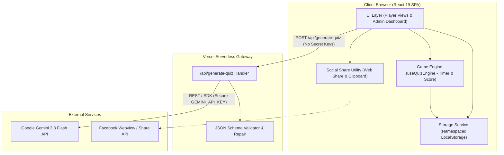
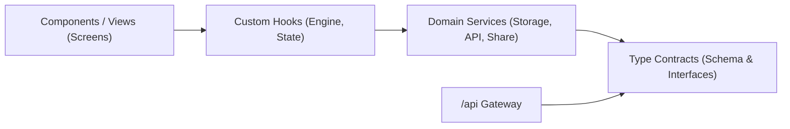

# Architecture Spine — QuizVibe AI

## Design Paradigm

**Client-Centric Modular Architecture with Serverless Security Gateway**:
QuizVibe AI runs as a high-performance single-page application (SPA) where 100% of game state, business logic, lead collection, and leaderboard persistence executes directly within the client browser via isolated storage services. A lightweight **Vercel Serverless Gateway** (`/api/generate-quiz`) acts exclusively as an untrusted client isolation layer: it stores the `GEMINI_API_KEY`, queries Google Gemini 3.8 Flash, validates outputs against a strict JSON schema, and performs one-shot repairs. Zero business data is persisted on the server.



---

## Invariants & Rules

### AD-1 — Zero Persistent Backend Database [ADOPTED]
* **Binds:** `FR-302`, `FR-401`, `FR-402`, `FR-601`, `NFR-5`, all data access layers.
* **Prevents:** Divergence where downstream developers spin up a database (PostgreSQL, MongoDB, Supabase, Firebase) or cloud auth service, violating competition simplicity constraints.
* **Rule:** All application entities (campaigns, leads, leaderboard) MUST be accessed through the `StorageService` abstraction targeting `localStorage`. Under no circumstances may an external database or session backend be introduced.

### AD-2 — Secret Key Isolation via Serverless Gateway [ADOPTED]
* **Binds:** `FR-102`, `FR-103`, `NFR-3`, build configs, environment variables.
* **Prevents:** Leakage of Google Gemini API keys into client bundles, GitHub commits, or client-side `VITE_` environment variables.
* **Rule:** `GEMINI_API_KEY` MUST exist solely within server-side environment variables on Vercel. The client web application MUST call `/api/generate-quiz` without credentials. No environment variable prefixed with `VITE_` may contain an API secret.

### AD-3 — Deterministic Timer & Scoring Mutual Exclusion [ADOPTED]
* **Binds:** `FR-202`, `FR-203`, `FR-204`, `TC-02`, `TC-05`.
* **Prevents:** Race conditions where fast clicking, double-tapping, or timer expirations trigger duplicate points, multiple transitions, or answers recorded after `00:00`.
* **Rule:** All timer state and question transitions MUST be governed by a single stateful hook (`useQuizEngine`). Once an answer is selected OR the timer hits `00:00`, the engine MUST set an atomic `isLocked: true` flag. Any click event received while `isLocked === true` MUST be dropped as a no-op.

### AD-4 — Gated Leaderboard Write Pipeline [ADOPTED]
* **Binds:** `FR-302`, `FR-401`, `FR-402`, `TC-03`.
* **Prevents:** Anonymous users, unverified leads, or malformed phone numbers polluting the Top 10 leaderboard.
* **Rule:** Writing an entry to `quizvibe_leaderboard` is permitted ONLY via `StorageService.submitLead()`, which enforces runtime validation:
  1. `fullName` must be a trimmed string with length $\ge 2$.
  2. `phoneNumber` must match regex `/^(03|05|07|08|09)\d{8}$/`.
  3. Records that fail validation MUST NOT be persisted to `quizvibe_leads` or `quizvibe_leaderboard`.

### AD-5 — Strict AI Output Schema & Graceful Degradation [ADOPTED]
* **Binds:** `FR-102`, `FR-103`, `FR-104`, `TC-06`.
* **Prevents:** Unhandled JSON syntax errors, wrong question counts, hallucinated options, or unhandled 500 errors crashing the admin interface.
* **Rule:** The `/api/generate-quiz` endpoint MUST validate the LLM output against the strict 5-question schema (`questions` array of length 5, each with `question`, 4 `options`, and `correctIndex` in `0..3`). If invalid, it must perform one programmatic repair attempt. If still invalid or timed out (>10s), it MUST return HTTP 502/504 with `{ ok: false, error: string, canFallback: true }`, enabling the client to activate the offline Mock Quiz generator without crashing.

### AD-6 — Excel-Compatible CSV Serialization [ADOPTED]
* **Binds:** `FR-602`, Admin lead operations.
* **Prevents:** Vietnamese diacritics rendering as corrupted mojibake characters when merchants open exported lead files in Microsoft Excel on Windows.
* **Rule:** The CSV export function MUST prepend the UTF-8 Byte Order Mark (`\uFEFF`) to the generated string before instantiating the `Blob` (`new Blob(["\uFEFF" + csvContent], { type: "text/csv;charset=utf-8;" })`).

---

## Dependency Direction & Boundary Rules



* **Rule 1**: Components must never invoke `localStorage` directly; all reads/writes must pass through `StorageService`.
* **Rule 2**: `useQuizEngine` owns gameplay timer loops and scoring calculation; components merely render state and dispatch user choices.
* **Rule 3**: `api/generate-quiz` must remain a standalone Node/Edge function with zero runtime dependency on the React frontend.

---

## Consistency Conventions

| Concern | Convention | Example / Specification |
| :--- | :--- | :--- |
| **Storage Keys** | Prefix `quizvibe_` + lowercase noun | `quizvibe_active_campaign`, `quizvibe_leads`, `quizvibe_leaderboard` |
| **Component Files** | PascalCase in dedicated directories | `src/components/player/QuizGameScreen.tsx`, `src/components/admin/QuizBuilder.tsx` |
| **Domain Services** | camelCase singleton objects | `src/services/storageService.ts`, `src/services/aiService.ts` |
| **Custom Hooks** | camelCase starting with `use` | `src/hooks/useQuizEngine.ts`, `src/hooks/useTimer.ts` |
| **Error Envelopes** | Standardized JSON response | `{ success: boolean, data?: T, error?: string, code?: string }` |
| **Phone Format** | 10-digit string, no spaces/hyphens | `0912345678` (validated against `/^(03\|05\|07\|08\|09)\d{8}$/`) |
| **Timestamps** | ISO 8601 UTC strings | `2026-11-02T15:00:00.000Z` |

---

## Stack (Pinned & Verified Versions)

| Technology | Role | Verified Version / Identifier | Rationale |
| :--- | :--- | :--- | :--- |
| **React** | View Library | `^19.0.0` | Latest React production baseline; optimal rendering speed. |
| **TypeScript** | Type Safety | `^5.6.0` | Strict type checking across game engine and storage models. |
| **Vite** | Build Tool | `^6.0.0` | Ultra-fast HMR and minimal bundle footprint. |
| **Tailwind CSS** | Styling Engine | `^4.0.0` or `^3.4.17` | Utility-first design tokens matching `DESIGN.md`. |
| **Lucide React** | Iconography | `^0.470.0` | Clean, accessible SVG iconography. |
| **Google Gemini API** | Real AI Engine | `gemini-3.8-flash` | Active Google Gemini API model in late 2026; high-speed and cost-effective. |
| **Vercel Serverless** | API Gateway | Node.js 20+ runtime | Native serverless function deployment for `/api/generate-quiz`. |

---

## Structural Seed (Directory Scaffold)

```text
QuizVibe-AI/
├── api/
│   └── generate-quiz.ts       # Vercel Serverless Proxy (Gemini 3.8 Flash + Schema Validation)
├── public/
│   └── favicon.svg            # Brand favicon
├── src/
│   ├── assets/                # Static images & icons
│   ├── components/
│   │   ├── common/            # Header, Footer, Modal, Toast, Button
│   │   ├── player/            # WelcomeScreen, GameScreen, ResultScreen, LeaderboardModal, ShareDrawer
│   │   └── admin/             # AdminDashboard, QuizBuilder, AIReviewGate, VoucherConfig, LeadTable
│   ├── data/
│   │   └── defaultCampaign.ts # Fallback initial campaign & mock presets (Fashion, Cosmetics, Tech, F&B)
│   ├── hooks/
│   │   ├── useQuizEngine.ts   # 30s countdown, speed scoring, timeout locks, transition manager
│   │   └── useStorage.ts      # Reactive hook syncing with localStorage events
│   ├── services/
│   │   ├── storageService.ts  # CRUD for campaigns, leads, leaderboard, CSV export
│   │   ├── aiService.ts       # Client wrapper invoking /api/generate-quiz with fallback
│   │   └── shareService.ts    # Web Share API + clipboard fallback
│   ├── types/
│   │   ├── quiz.ts            # Campaign, Question, Option, Voucher interfaces
│   │   └── lead.ts            # Lead, LeaderboardEntry interfaces
│   ├── App.tsx                # Role-switcher router (Player View vs. Admin Dashboard)
│   ├── main.tsx               # React 19 root bootstrap
│   └── index.css              # Tailwind imports & CSS variable mappings
├── .env.example               # GEMINI_API_KEY sample (server-side only)
├── vercel.json                # Serverless function rewrite rules
├── package.json
├── tsconfig.json
└── vite.config.ts
```

---

## Capability → Architecture Map

| Capability / Requirement | Living Location | Governed By |
| :--- | :--- | :--- |
| **FR-101 (Manual Quiz Authoring)** | `src/components/admin/QuizBuilder.tsx` | Form validation rules |
| **FR-102 (AI Generation with Gemini)**| `api/generate-quiz.ts` & `aiService.ts` | `AD-2`, `AD-5`, `gemini-3.8-flash` |
| **FR-103 (AI Resilience & Fallback)** | `api/generate-quiz.ts` & `defaultCampaign.ts`| `AD-5` (1-shot repair, mock fallback) |
| **FR-104 (Mandatory Review Gate)** | `src/components/admin/AIReviewGate.tsx` | Visual editor state pattern |
| **FR-105 (Voucher Configuration)** | `src/components/admin/VoucherConfig.tsx` | `quizvibe_active_campaign` schema |
| **FR-201 to FR-204 (Gameplay & Timer)**| `src/hooks/useQuizEngine.ts` | `AD-3` (30s timer, formula $100+10s$, lock) |
| **FR-301 to FR-303 (Results & Leads)** | `src/components/player/ResultScreen.tsx` | `AD-1`, `AD-4` (Phone regex validation) |
| **FR-401 to FR-402 (Top 10 Leaderboard)**| `src/components/player/LeaderboardModal.tsx`| `AD-1`, `AD-4` (Score DESC, Time ASC) |
| **FR-501 to FR-502 (Facebook Share)** | `src/services/shareService.ts` | Web Share API + Clipboard fallback |
| **FR-601 to FR-602 (Admin Lead Ops)** | `src/components/admin/LeadTable.tsx` | `AD-6` (`\uFEFF` UTF-8 BOM CSV export) |

---

## Deferred Items

1. **Multi-tenant Cloud Authentication**: Deferred post-competition. Client role-toggling satisfies Table A rules without backend server overhead.
2. **Server-Side Persistent Relational Database**: Deferred post-competition. LocalStorage satisfies 100% of the competition demo and grading rubric.
3. **SMS OTP Telephone Verification**: Deferred post-competition. Regex validation ensures correct format without third-party telecom gateway costs.

